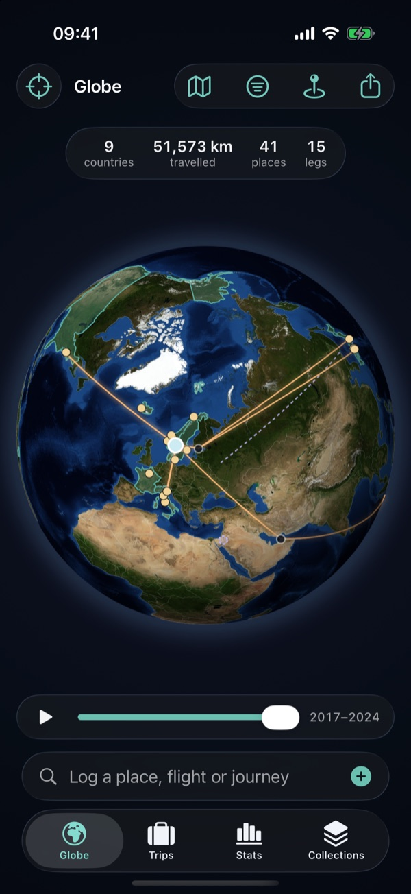
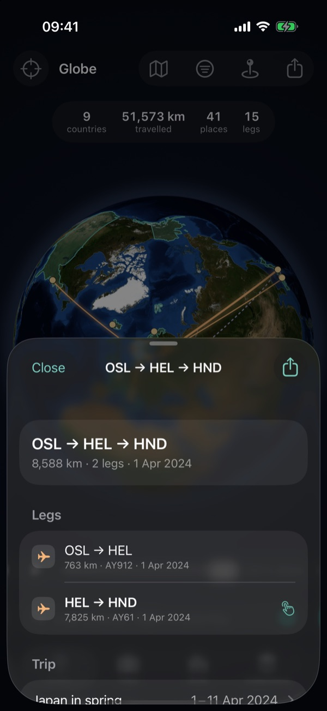
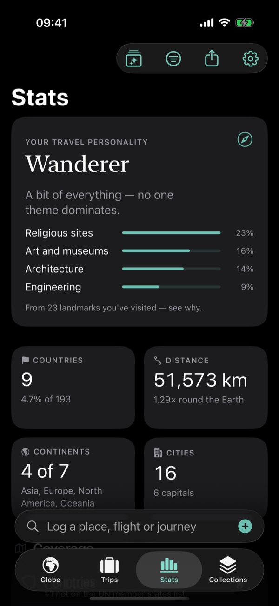
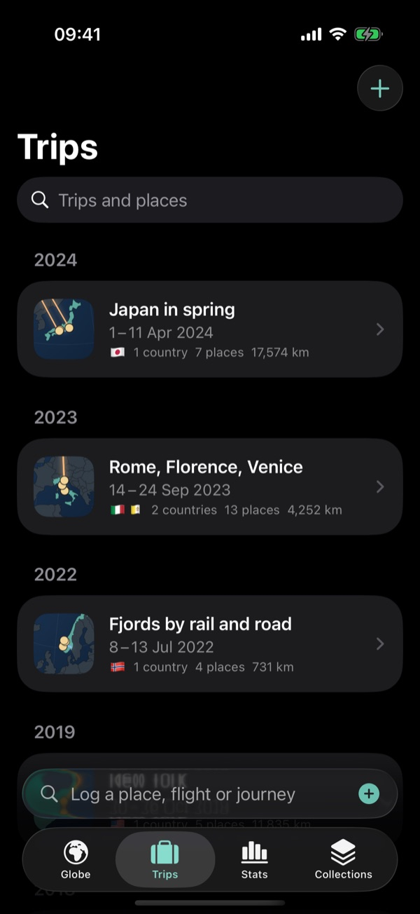
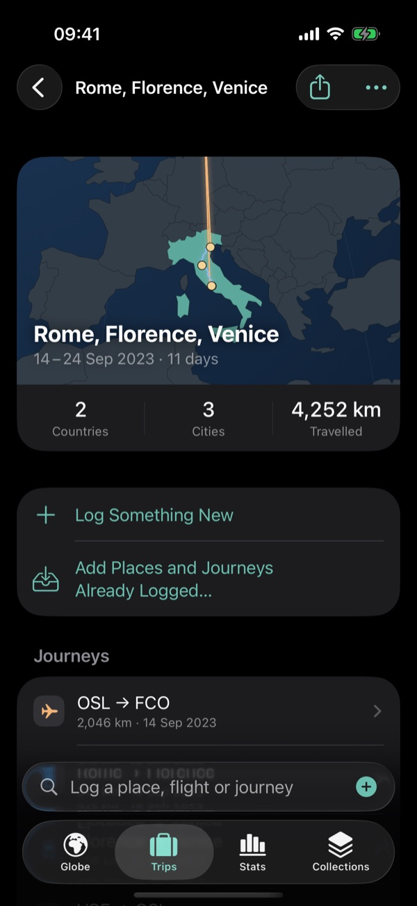
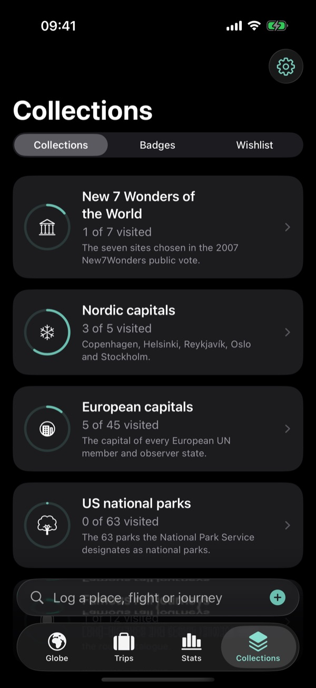

<p align="center">
  
</p>

<h1 align="center">Antipodes</h1>

<p align="center">
  A private travel log for iPhone, iPad and Mac.<br>
  Every place, flight, train and ferry on one globe, with statistics worth reading.
</p>

<p align="center">
  
  
  <a href="LICENSE"></a>
  
</p>

<table align="center">
  <tr>
    <td></td>
    <td></td>
    <td></td>
  </tr>
  <tr>
    <td></td>
    <td></td>
    <td></td>
  </tr>
</table>

## Features

- **Every way you travel.** Places, flights, rail, coaches, ferries, road trips, hikes,
  city transit and cable cars, with multi-leg journeys and connections. Rail and road
  legs are measured along the real network, not as straight lines.
- **Fast to log.** Search a bundled offline database of cities, airports, stations and
  landmarks, and tap. No account, no typing coordinates.
- **Statistics with substance.** Countries and continents, distance and time in the air,
  days away per year, the age of the landmarks you've seen, your carbon footprint, and a
  travel personality that shows its working.
- **Trips, collections and badges.** Group journeys into trips, tick off the New 7
  Wonders or every US national park, and keep a wishlist that ticks itself off.
- **Bring your history.** Import from Flighty, myFlightradar24, OpenFlights or a rail
  log CSV, or find past trips in your photos, on the device.
- **Share it.** Cards for a stat, a trip or a year, Year in Review, and Home and Lock
  Screen widgets.

**Private by design.** Your log is stored only on your device. There is no account,
no server, no analytics and no sync. A JSON backup in Settings is how you keep a copy or
move to a new device.

## Building

Antipodes isn't on the App Store; you build it from source. You need macOS with
**Xcode 27** (Swift 6.4) and `python3`. There are no third-party Swift dependencies.

```bash
git clone https://github.com/leeyenkai/Antipodes.git
cd Antipodes
scripts/build-app.sh   # fetches and builds the place database, borders and imagery on first run
open Antipodes.xcodeproj
```

Then run the `Antipodes` scheme on an iPhone or iPad simulator, or on My Mac; a real
iPhone needs your own signing team. The first build downloads the open data the app
bundles (a few hundred MB, cached in `Tools/placedb/vendor/`).

| Script | What it does |
|---|---|
| `scripts/check.sh` | Everything: data, package, tests, lint, and the iOS and Mac app builds |
| `scripts/test.sh` | The test suite, with no simulator and no network |
| `scripts/lint.sh` | SwiftFormat and SwiftLint |
| `scripts/build-placedb.sh` | Builds `places.sqlite` from the cached open data |

## Project layout

```
AntipodesKit/    Swift package with all the logic and UI, one module per concern
App/             The thin app shell and the widgets extension
Tools/placedb/   Python pipeline that builds the offline place database
docs/            The product specification
scripts/         Build, test and lint helpers
```

The [specification](docs/SPECIFICATION.md) holds the requirements and the decisions
behind them. [AGENTS.md](AGENTS.md) covers the architecture, conventions and the module
dependency rule, for people and coding agents alike. Changes are recorded in the
[changelog](CHANGELOG.md).

## Data and credits

The place database is built from open data: [Natural Earth](https://www.naturalearthdata.com),
[GeoNames](https://www.geonames.org) (CC BY 4.0), [OurAirports](https://ourairports.com),
[Wikidata](https://www.wikidata.org), the UK Government's
[GHG conversion factors](https://www.gov.uk/government/collections/government-conversion-factors-for-company-reporting)
(OGL v3.0) and [TerraClimate](https://www.climatologylab.org/terraclimate.html). The
satellite globe uses NASA's
[Blue Marble Next Generation](https://visibleearth.nasa.gov/collection/1484/blue-marble).
Each source's licence and what it requires are set out in
[Tools/placedb/SOURCES.md](Tools/placedb/SOURCES.md), and the app credits them in
Settings.

## Licence

The code is released under the [MIT licence](LICENSE). The curated lists in
`Tools/placedb/curation/` are CC0. The open data keeps its own licence, as above.
